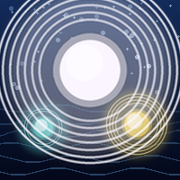

# Ocean of Souls

> Souls grow, die and return. Soul levels, reincarnation and the Pantheon.

**[Download Ocean of Souls 0.0.2](https://github.com/AgricheX/Ocean-Of-Souls/releases/latest/download/OceanOfSouls.zip)**

| | |
| --- | --- |
| Game | WorldBox (current version) |
| Mod loader | NML |
| Version | 0.0.2 |
| Author | Agriche |

English first, português do Brasil logo abaixo.

---

## English

### What it adds

- Every unit has a soul that grows across lives, through 8 soul levels.
- Reincarnation: souls die and come back in new bodies, keeping their history.
- The Protagonist trait.
- 5 Golden Fingers: Absorb, Aura, Memory, Second Chance and System.
- Immortal and Infinite Reincarnation traits.
- The Pantheon: a window that lists the greatest souls of your world.

### How to install

1. Install NML for WorldBox (current version).
2. Download **OceanOfSouls.zip** with the link above.
3. Extract it into the `Mods` folder of your WorldBox installation, so you get `Mods/OceanOfSouls/mod.json`.
4. Start the game.

### Help

Questions and bug reports: [Agriche Community on Discord](https://discord.gg/s3EbgNSsJW).

---

## Português (Brasil)

### O que o mod adiciona

- Cada unidade tem uma alma que cresce ao longo das vidas, em 8 níveis de alma.
- Reencarnação: as almas morrem e voltam em corpos novos, guardando sua história.
- O traço Protagonista.
- 5 Dedos de Ouro: Absorção, Aura, Memória, Segunda Chance e Sistema.
- Traços Imortal e Reencarnação Infinita.
- O Panteão: uma janela com as maiores almas do seu mundo.

### Como instalar

1. Instale o NML para o WorldBox (current version).
2. Baixe o **OceanOfSouls.zip** pelo link acima.
3. Extraia na pasta `Mods` do WorldBox, de forma que fique `Mods/OceanOfSouls/mod.json`.
4. Abra o jogo.

### Ajuda

Dúvidas e bugs: [Agriche Community no Discord](https://discord.gg/s3EbgNSsJW).

---

WorldBox © Maxim Karpenko. This is a free, fan-made mod, not affiliated with the WorldBox developers.
